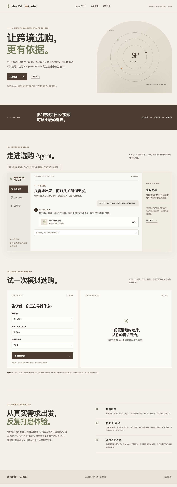

# ShopPilot-Global 静态演示页

这是为简历展示独立制作的静态交互原型。页面提供 Agent 工作台、我的心愿单、我的 Skill 等功能示意，以及可操作的模拟选购流程。商品、价格、运费和推荐规则均为示意数据，不连接真实 Agent、数据库、库存或支付，也不包含 API Key。

## 本地查看

直接打开 `index.html`，或在本目录执行 `python3 -m http.server 8001` 后访问 `http://127.0.0.1:8001/`。页面由原生 HTML、CSS 和 JavaScript 组成，不需要安装依赖。

## 上传到 GitHub Pages

1. 在自己的 GitHub 账号中新建仓库，例如 `shop-pilot-global-demo`。只上传这个独立静态演示目录中的网页文件。
2. 将本目录的 `index.html`、`styles.css`、`script.js`、`README.md` 和两张 `preview` 图片放在仓库根目录并提交。
3. 在仓库的 **Settings → Pages** 中，将发布来源设为 **Deploy from a branch**，选择 `main` 分支和 `/ (root)`，保存。
4. 等待 Pages 构建完成；访问 `https://你的用户名.github.io/shop-pilot-global-demo/`，在电脑和手机上都试一次选购流程。

GitHub Pages 只能运行静态前端。这份页面里的推荐是本地预设规则，不是实时 AI 回答。若以后计划提供真实 Agent 体验，还需要另外部署后端、确认所使用代码的公开部署权限、设置访客隔离、调用限额和服务器端密钥。
